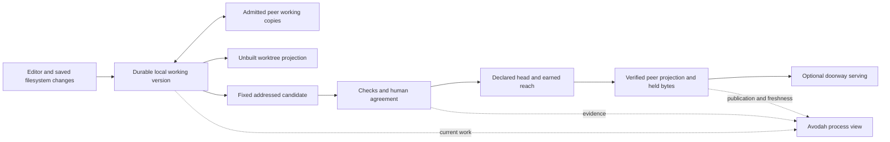

# Shared working versions and the social-coding commons

## Purpose and authority

Avodah is the protocol's process lens: work, service, and worship expressed through EPRs,
REA acts, and their governance. The same work becomes legible as a project, a branch, an
agreement, a contribution, or a continuing habit. This document joins the existing contracts;
it does not create another work database, governance evaluator, or progress register.

The operator's October 13 design decisions combine two passes: the local-first architecture
and the commons reading that enriches it. Both remain binding here. The contract applies to
all editable EPR content; collaborative coding across Matthew's devices and Ethosengine is
the proving case. Taiga supplies the navigational precedent (project, backlog, board, detail):
its [backlog template](https://github.com/taigaio/taiga-front/blob/main/app/partials/backlog/backlog.jade)
exposes filtered versus total counts, and its
[board template](https://github.com/taigaio/taiga-front/blob/main/app/partials/kanban/kanban.jade)
exposes filters and board zoom. These are UX precedents, not imported persistence or authority.
The existing Backstitch research supplies the live-work/snapshot composition precedent.

This is a **design and acceptance-specification delivery**, not a claim that the collaboration
runtime has shipped. No charter is ratified by writing it here. Resource ratios, membership
ceilings, consequence thresholds, and collective closure parameters are the members' choices.

## 1. Existing map, grounded 2026-10-13

“Implemented” below means inspected executable source, not a new runtime proof. “Designed”
means a contract exists; “missing” means the inspected path does not establish the connection.
Source locators refer to the named symbols so line movement does not change their meaning.

| Boundary | Existing evidence | What it does not yet prove |
|---|---|---|
| Avodah reads and edits | `app/elohim-app/src/app/avodah/services/avodah-api.service.ts`, `updateStoryStatus`, reads ContentNodes and patches metadata over HTTP; the public alpha `/avodah` landing rendered without captured errors in this discovery pass | Authenticated board operation, offline persistence, or a witnessed state transition; the landing render proves only reachability |
| Work files to accountable readings | `elohim/eprfs/epr-cli/src/flow/project.rs` derives CID-deduplicated records; `flow/context.rs::ContextResult` and `flow/walk.rs` expose commitments, habits and independent evidence readings | The developer recipe does not yet join every timeline backlog entry; local sidecar records are not automatically DHT-notarized |
| Client transport selection | `app/elohim-library/projects/elohim-service/src/connection/connection-strategy-factory.ts` and the direct/Tauri/doorway strategies; Che same-origin proxy | A browser URL does not establish hosted custody or permission; runtime agency heuristics are not authorization evidence |
| Mutable documents | `elohim/sdk/storage-client-ts/src/sync.ts`; `content-doc-sync.service.ts` holds documents in memory; storage `src/sync/doc_store.rs` persists server documents | Durable browser drafts, live filesystem/editor adapters, edit-circle enforcement and the complete native authoring loop remain missing |
| Metadata to notary | `elohim/elohim-storage/src/http.rs::version_patch_needs_conductor` distinguishes conductor writes from local projection updates | A normal Avodah status metadata patch does not become notarized merely because a conductor is running |
| Published document sync | Storage `src/sync/projector.rs` includes metadata but restricts the broadcast projection to `community/public/commons` and protects anchored authority on reverse projection | This allowlist lacks per-recipient edit-circle admission; changing private story reach is not its cure, and CRDT input cannot elect a canonical head |
| Fixed source bridge | `elohim/brit/brit-bridge/src/lib.rs::{seal_git_tree,restore_git_tree}` implements committed-tree ↔ canonical EPRFS-tree translation | Live branch editing, ref advancement, index mutation or permission; August research claiming the bridge absent is historical |
| Source on disk | `elohim/eprfs/eprfs-local/src/lib.rs::LocalMaterializer` verifies addressed bytes and supports sparse/fetch-missing materialization | Continuous bidirectional worktree synchronization, semantic merge, or authorization to run those bytes |
| Workspace runtime | LVI's devspace and arrival specs allocate brit/eprfs/rakia/doorway ownership | LVI remains documentation-only in the inspected tree; warming, hosting and shared compilation are not delivered by this specification |
| Device participation | EPR actor device roster; Mishpat `device_enrollment.rs`; `app/elohim-app/scripts/hc-start.sh` join-alpha path | Developer key, conductor key and storage identity are separate mechanisms awaiting a verified association; another device is not a copied human key |
| Space-qualified sync | The cell-qualified projection contract states its target boundary; storage `src/db/context.rs::AppContext` remains app/peer scoped | Current storage has no demonstrated cell/clone qualification; sharing a document ID or app name does not prove a common space |
| Readiness and builds | `epr-cli/src/ready.rs`; `.husky/pre-push.bash`; `genesis/orchestrator/gate-runner.mjs`; brit attestation refs | A complete durable request→running→outcome→acceptance stream and immutable build checkout under continuing edits are not established |
| Serving | Doorway `src/projection/epr_router.rs` reads projection commitments; `src/services/name_routing.rs` forwards to an authorized holder and preserves refusal | Transport availability is not evidence that the receiver verified or adopted the requested head |

Che already exposes `angular-dev` on 4200 and `ui-playground` on 4201 in `devfile.base.yaml`.
`genesis/a2o/scripts/serve-reports.ts` serves an existing `/delivery` reading. These are delivery
adapters, not an offline store or a second governance home. Reuse the current Avodah domain and
client connection seam; no new application workspace is required by this contract.

The diagram is the target composition. The evidence table above determines which connecting
arrows are implemented; drawing an arrow supplies no delivery or authority proof.

## 2. Branch birth and live participation

A branch is a governed EPR working context, born with a purpose and an intended destination.
Its **current audience**, **collaboration mode**, **intended reach**, **governing agreement** and
**execution permissions** are separate declarations. Branch properties project the governing
records; permission never comes from an editable field inside the shared CRDT.

1. Brit's default creates live attributed proposals visible across Matthew's **already-admitted
   devices**, under his standing sharing choice. No fresh permission is needed per file. If the
   standing choice or its enforceable admission is absent, retain the work device-private and
   explain why; changing defaults does not silently widen existing branches.
2. A project agreement supplies a branch template: purpose, intended reach, the gates needed
   to earn it, and applicable collaboration terms. Birth context selects the workspace channel.
   These compose with the own-device default; neither a channel name nor a production goal
   grants present disclosure to Ethosengine or the public.
3. An explicit device-private option keeps exploration on its originating device: no listing,
   filenames, presence or edit announcements, synchronization, or automatic custody elsewhere.
4. A person follows a branch as they would check out a worktree. Following materializes source;
   the branch's human-authorized standing agreement decides whether following also admits
   co-editing or remains a read-only subscription. A tool applies that grant, never admits a
   member on its own authority.
5. Agents make attributed proposals by default, acceptably merged whole or in part. Explicit
   branch terms may authorize live shared editing under a bounded mandate; merely running on
   Matthew's device does not. This declared exception to the default draft discipline comes
   from the operator's branch-mode decision, not an agent self-grant.
6. Connected editors exchange text operations live. Ordinary tools and agents contribute saved
   filesystem changes through an adapter to the same working-version contract. Binary bytes
   remain addressed blobs. Presence and cursors are passing state, not durable history.
7. Compatible concurrent changes merge; ambiguous text, rename/delete, and competing binary
   replacements retain inspectable alternatives. No silent overwrite of unsent local edits,
   no claim that mechanical convergence establishes semantic correctness.

Policy changes are governed acts outside merged values. Branch templates cannot relax the
applicable charter floor, and later policy edits do not silently rewrite an active ceremony.

## 3. Local-first reading

- **Alone, key on the device:** read held published bytes and evidence, retain working versions,
  prepare/fix/sign acts within present authority, and materialize source. Remote witnessing or
  another person's agreement may wait; the device's own preparation does not.
- **Alone, key held by a doorway:** read verified held bytes, persist browser drafts, and fix an
  addressed candidate. Signing waits for the key holder; show “not saved to account.” A hosted
  doorway sees what it handles and can sign for the hosted person. It receives no solo thoughts.
- **Alone, no key:** read supplied material for the visit; no persistent personal work or attributed
  act is claimed. Explain what will not survive the visit.
- **Working version:** author or explicitly admitted shared circle; separate document from the
  published projection. Default own-device sharing is the author's standing choice; device-private
  overrides it. Signed authorization determines editors and publication, never a merged field.
- **Each kind of state:** selection/layout stay on the device; presence passes unstored; mutable
  values persist in the holder's working store; fixed source, claims and witnessed publication
  remain distinct. Local, signed, anchored, pending, elected and not-current are not synonyms.
- **Shown to the person:** local-only work, per-copy caught-up/behind/unknown, evidence scope and
  age, pending/current/not-current publication, and what a wait depends on.
- **Refusals:** no doorway-first authoring, widening reach to obtain sync, public storage of private
  drafts, execution on receipt, or cached evidence described as a fresh measurement.
- **Stands as is:** the existing native readings, snapshot bridge and verified materializer;
  client transport selection and doorway serving remain adapters over the same record.

| Arrival | Adds | Learns | What survives its loss |
|---|---|---|---|
| Another own device | Another holder and place to work | Only subscribed, authorized work and its synchronization metadata | Held work remains usable; device-private work never left its origin |
| Another person | Contribution, review and shared editing under an agreement | The admitted branch and participants within that circle | Local work and permitted retained copies; new acts still obey current authority |
| Always-on holder/hub | Availability, custody and optional delegated capacity | Admitted plaintext or opaque byte sizes/timing, according to the actual custody contract | Local reading, drafts and preparation |
| Doorway | Web access and authorized projection serving | Requests and any plaintext/signing it handles; it is inside the circle only when admitted | Native reading/authoring and held browser data |
| Commons facility | Pooled resources under a charter | Only the declared accounting; current public pool mechanisms expose membership/compute draws | Each member's own material and unfinished work |

Back-fill checks: delete all doorways and the own node still persists, fixes and signs authorized
work; close the browser and reopen offline and the last acknowledged local edit remains; the
first unavoidable external wait is another party's act or remote witnessing. Hosted signing is
an external dependency of that custody arrangement, not a prerequisite imposed on own-key users.

The current client labels in `imagodei/models/agency.model.ts` are `visitor`, `hosted`,
`hosted-steward` (recovery), `app-steward`, and `node-steward`. Read them as views of the
independent axes above: a visitor has a temporary reading; a hosted person prepares locally
but waits for account signing; a recovery session retains held work without manufacturing
new authority; an app-steward can act through the device's verified authority; an always-on
node adds availability/capacity, not more votes or automatic admission. The domain metadata's
`observer/participant/steward/elder` vocabulary and the Che arc's hosted/peer/delegated phases
are different axes, not a conversion table. Existing URL/localStorage heuristics cannot
decide rights. Acting with or for another person needs its actual bounded, appealable grant;
hosted key custody does not itself establish guardianship or diminished agency.

## 4. Publication, serving and the execution boundary

The conductor witnesses fixed acts; it does not carry every editor operation. Working-version
values and blob bytes move through their authorized storage/peer paths. Distinguish receipt,
local verification, canonical head adoption, byte availability and successful serving.

Before workspace publication can reach Matthew's hub/fleet: verify the developer/conductor/storage
identity association, persistent keys/cells, DNA **including modifiers/network identity**,
coordinator capability, transport and authority bounds. Developer roster membership is not itself
a head-declaration delegation. A delegated write goes through the delegate's own conductor.
Remote gossip is not a local-author post-commit callback; remote projection must use the verified
reconciliation path. Different DNA lineages require explicit provenance-preserving migration.

Materialize into an opted-in collaboration worktree without modifying an unrelated checkout,
index or ref. Capture saved edits without synchronization loops. Receipt remains **unbuilt**:
build tools, package hooks, editor tasks, test watchers and dev servers cannot automatically
execute changed source there. Explicit execution uses a separate admitted environment. Shared
compilation spaces remain a later agreement and delivery, not an implication of following.

A gate request fixes the source identity, target ref/reach, policy, execution inputs and actor
before reviewers are selected or evidence evaluated. Build/test a distinct immutable candidate,
not the changing collaboration tree. Preserve request, running, interruption, refusal, outcome,
review/consent, ref advancement and earned reach as separate acts. Subsequent edits have a new
candidate; old evidence stays valid for its original subject, never transfers by branch name.
Changed governing terms require renewed evaluation/consent for the affected request.

Husky is an adapter into this ceremony, Rakia owns build execution, brit owns source/ref semantics,
and the shared governance evaluator supplies the decision. Avodah cannot infer a successful merge
or deployment from a green process exit. Feature→dev retains the repository's local fast-forward
ceremony; dev→main retains PR review. A failed test concerns a candidate, a permission refusal
enforces an existing boundary, and a sanction is a separate human-governed consequence.

## 5. Commons application and P2P classification

Matthew's own-device circle is not automatically Ethosengine's commons. The facility comprises
committed storage, synchronization bandwidth, serving and maintenance/review labor; shared
compute is separately declared when introduced. Source, ideas, proposals, agreements and evidence
are its artifact side. The pool design's social-coding application owns the eleven declarations,
rights, probes and human/agent labor division; existing backlog rows 32–38 own the missing nodes.

No new entry type, HTTP route, schema, standing enum or independently computed verdict is added
by this documentation delivery. Reuse decisions below are boundaries, not claims of a shipped join.

| Subject | Existing primitive / class | Authority and address | Incremental head cost |
|---|---|---|---|
| Working source/plan | Separate mutable working document; outside the five published-entity classes | Holder store; agent-scoped identity, circle authorization separate | No per-edit notary head |
| Fixed source candidate | Existing brit/EPRFS addressed tree | Content-derived CID; address establishes bytes, not acceptance | No head merely for constructing a snapshot |
| Published content | Existing `content_store_integrity::Content`, A | Content CID plus actual conductor entry/action provenance and declared head | Reuse the subject's head; never mint heads per keystroke/file receipt |
| Work intent, commitment, outcome | Existing REA primitives; witnessed acts A, native local records retain their present status | Content-derived native records; conductor APIs return their actual entry/action fields | No mass import or per-editor-operation commitments |
| Circle/collective authority | Existing Collective/Commitment mechanisms, A; linked attributes A2 only where an actual link path fits | Signed/notarized authority, never the CRDT's own membership list | Sized per relationship/agreement, not per synchronized item |
| Board, counts and local worktree | Reconstructible projection, C; selection is not an entity | Source-addressed readings and local materialization | None |
| Private thoughts/attention | Device-private; chosen private-chain checkpoint B only when appropriate | Never imported into collective accounting or common custody | None from this contract |

Existing content-store REA coordinator functions and projection signals are reusable; they are
not an automatic bridge from the developer's private sidecar. The initial read projection adds
zero notary heads at seed and one year. Eventual branch/circle/charter publication must price actual
counts and recurring costs at its owning gate before implementation; no unbounded head creation
is authorized here. Floor-protected authority, privacy and counter-evidence hold at every network
stage. SDO/RWA reading: an outside observer must not infer private-circle participation through
discovery, draw accounting or doorway caches. Current public pool mechanisms fail that use case;
the private carrier is a prerequisite, not a reach label on public metadata.

## 6. Avodah as the inexpensive process projection

Read the existing native records and folds. A backlog concern is a recognized need; a scenario
states an intended experience and probe; a valueflow records accountable work; a habit is a
continuing standard; Rakia supplies build dependencies and evidence. Join them by declared
relationships and concern identifiers, never by title similarity or a parallel task database.

The performance project is the first useful reader: purpose → habit → concern → undertaking →
produced change → review → measured outcome. Show code-produced, reviewed, accepted, built,
household-measured and fleet-measured independently, with candidate, environment, time and receipt.
Compare a fixed baseline cohort with the same cohort today; show new/retired/split/blocked scope
separately. File creation dates cannot manufacture past status. Unknown history stays unknown.

Subscribe through one bounded project/branch cursor or snapshot contract; do not poll every card
against the conductor. Persist held browser data for offline reading. Existing native context and
walk outputs own the readings; adapters join them without re-deriving verdicts. A card movement
requests a native act and displays its actual result. The same authorized projection can be read
locally, through Che, or through an admitted doorway. Keep source/evidence freshness explicit.

Cybersyn is a chosen sensemaking surface, not an obligation to watch telemetry. Members' elohim
perform sensing and bring one concrete choice when human action is needed. Resource condition
and admitted draws may be inspected on demand; private attention and productivity surveillance
are excluded. Independent code review is not a collective vote, and more agents/devices give
Matthew no extra votes.

## 7. Acceptance and delivery frontier

The acceptance stories in `genesis/a2o/features/devflow/shared-working-versions.feature`
are specification, marked `@wip`
until their adapters and runtime behavior exist. Parsing them proves syntax, never the behavior.
The owning habit remains red; this document does not assert a measured stock-drain improvement.

The runtime proof must distinguish: offline local durability; own-device discovery/private
non-disclosure; admitted live collaboration and attributed acceptance; unbuilt materialization;
immutable candidate checks during further editing; truthful ceremony projection; verified hub
adoption and doorway serving; cross-space isolation; and each commons declaration plus its probe.
Withdrawal stops future admission but cannot erase copies already received. Artifact removal must
state the boundary between future serving, retained history and protected counter-evidence.

Delivery dependency order is persistent/authorized working versions → editor/filesystem adapters
and safe materialization → fixed-candidate ceremonies → cheap Avodah subscriptions → verified
peer/doorway delivery. Commons facilities additionally require their human-ratified charter,
member choices and privacy path before narrow-circle pooling. The useful read-only project view
can be delivered from current native readings independently, but cannot graduate the editable path.
Shared compilation, a new LVI runtime, bulk backlog migration, identity enrollment and fleet
deployment are not performed by this design delivery.
